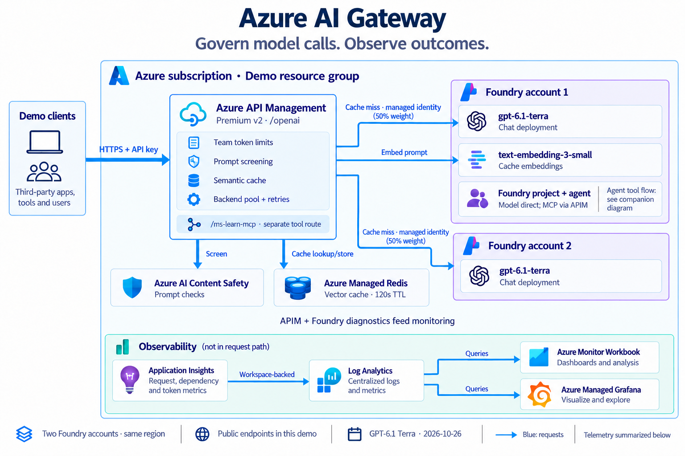
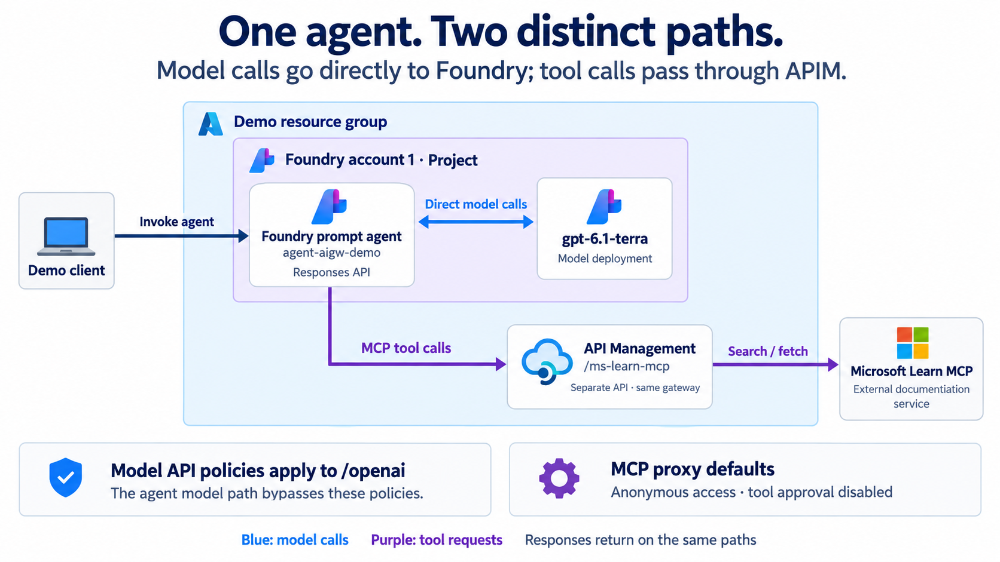

# Azure AI Gateway Demo

A reusable, customer-neutral lab for demonstrating Azure API Management in front of Microsoft Foundry models: team token limits, prompt screening, semantic caching, backend balancing and observable test outcomes.

This is a demonstration and pilot starting point. It includes Terraform infrastructure, six executable scenarios, an Azure Monitor workbook, a Managed Grafana dashboard and a presenter runbook.

## Architecture and scope



[Customer architecture guide](docs/architecture-guide.html) · [Public team repository](https://github.com/msftse-org/ai-gateway-demo)

The standalone guide explains the deployed resources, policy behavior, identity boundaries, APIM portal request, and customer walkthrough. Download the HTML file and open it locally; its diagrams are embedded for offline use. The public team repository includes the full reusable lab: Terraform, APIM policies, test clients, deployment scripts, dashboards, presenter runbook, and architecture diagrams.

| Component | Role |
|---|---|
| API Management | `/openai` model API, two team products/subscriptions, policies, backend pool and separate `/ms-learn-mcp` proxy |
| Two Foundry accounts | `gpt-6.1-terra` chat deployments; account 1 also hosts `text-embedding-3-small` and the project |
| Foundry project and prompt agent | Managed model/instructions/tool definition; Microsoft Learn MCP integration |
| Azure Managed Redis | Semantic response cache, partitioned by APIM subscription and deployment |
| Content Safety | Inbound prompt screening using APIM managed identity |
| Application Insights + Log Analytics | Request diagnostics, token metrics and gateway logs |
| Azure Monitor workbook + Managed Grafana | Two dashboard experiences over monitoring data |

Model test clients call APIM, which applies the model policies and forwards cache misses to Foundry. The prompt agent calls its model **directly in Foundry**. Its Microsoft Learn tool uses the separate APIM MCP API. That proxy is anonymous by default and does not inherit the model API's token, safety or cache policies. No custom agent container or MCP server is deployed.



## Quick start

Prerequisites: Azure CLI signed into the intended tenant/subscription, Terraform >= 1.6, Python 3.10+, permission to create resources and assign roles, and regional quota/capacity for the selected services. Premium v2 is the validated APIM tier for this lab; do not assume all tiers have identical feature support.

```bash
git clone https://github.com/msftse-org/ai-gateway-demo.git
cd ai-gateway-demo
az login
az account set --subscription '<your-subscription-id>'
cp infrastructure/terraform.tfvars.example infrastructure/terraform.tfvars
# Edit publisher email, owner, name_prefix, environment and regions.
./scripts/lab.sh setup
./scripts/lab.sh plan
./scripts/lab.sh deploy
./scripts/lab.sh test
```

`lab.sh` resolves the checkout directory, uses its own `.venv`, exports the active subscription/tenant to Terraform, verifies bootstrap status and generates `clients/.env` with owner-only permissions. Review the plan before confirming apply. All generated credentials, local settings, state and bootstrap output stay outside version control. Provider versions are captured in the committed lockfile.

Use a unique `name_prefix` and environment per customer or deployment. Use separate checkouts/state for independent environments. Never copy a deployed state file into a new customer checkout.

```bash
./scripts/lab.sh test 01 03 05  # chat, cache, prompt screening
./scripts/lab.sh export         # regenerate local client configuration
./scripts/lab.sh destroy        # review and confirm removal of this checkout's lab
```

## Configuration

| Input | Default / demo setting | Notes |
|---|---|---|
| `name_prefix` | `aigw` | 2–9 lowercase alphanumeric characters, starting with a letter |
| `environment` | `demo` | Resource group becomes `rg-<prefix>-<environment>` |
| `location` | `swedencentral` | Models and supporting services; verify availability |
| `apim_location` | same as main region | Optional gateway-only region override |
| `apim_publisher_email` | required | Set your own address in the ignored tfvars file |
| `chat_model_name` / `chat_model_version` | `gpt-6.1-terra` / `2026-10-26` | Verified GA in Sweden Central on 2026-10-28; check live availability and quota before deploying |
| `apim_sku_name` | `PremiumV2_1` | Validated demo tier; incurs ongoing cost |
| Team A | 500 TPM; 10,000 tokens/day | Product-scoped token control |
| Team B | 5,000 TPM | No configured daily quota |
| Safety threshold | module default 4; example uses 2 | Example setting supports the demo fixture; evaluate for real workloads |
| Semantic threshold | 0.2 | Lower means closer required match; not an accuracy guarantee |
| Cache TTL | 120 seconds in policy | Shared within each APIM subscription and deployment partition |

Cognitive Services local authentication is disabled and APIM uses managed identity for Foundry and Content Safety. Clients still use APIM subscription keys; Redis uses an access key. No security-control exemption tags are added. Public endpoints and local Terraform state are intentional demo choices.

## Test scenarios

Validated on 2026-10-28 with GPT-6.1 Terra (`2026-10-26`): all six scenarios passed, including actual MCP execution, and the portal request returned the new model. Re-run the checks before a customer session.

| Test | Assertion / scope |
|---|---|
| 01 basic chat | Successful model response and correlation |
| 02 load | Observable token throttling; daily quota exhaustion is not guaranteed |
| 03 cache | Three successful paraphrases with complete, identical response IDs |
| 04 balancing | All requests succeed and at least two backend hosts serve them |
| 05 safety | Benign request allowed; harmful fixture blocked |
| 06 agent | Answer plus actual MCP tool execution |

The runner prints a shared Test Run ID for the workbook. Wait for ingestion and select the appropriate time range. Repeated runs can hit existing rate/quota counters or a warm cache. The cache test primes the cache before measurement; it is not a cold/warm performance benchmark. Balancing does not prove forced failover.

## Chat Completions in the Azure portal

Open your API Management resource → **APIs → Foundry LLM API → Chat Completions → Test**.
Set `deployment-id` to `gpt-6.1-terra`, add query parameter `api-version=2024-10-21`,
and headers `Content-Type: application/json` and `api-key: <Dev Team B subscription key>`.
Find the key under **Subscriptions → dev-team-b-subscription → Show/hide keys**.
Add `x-test-run-id` with a unique label to find the call in monitoring.

```json
{
  "messages": [
    {"role": "system", "content": "You are a helpful Azure assistant. Answer clearly and briefly."},
    {"role": "user", "content": "Explain in two sentences how an API gateway helps manage AI applications."}
  ],
  "max_completion_tokens": 150,
  "reasoning_effort": "none",
  "stream": false
}
```

Expect HTTP 200, text in `choices[0].message.content`, the current model in `model`,
and `x-correlation-id` / `x-backend-host` response headers. The URL selects the
model deployment; a body `model` field is unnecessary. The demo disables reasoning
for short, predictable calls and uses `max_completion_tokens` instead of legacy
`max_tokens`. For reasoning workloads, select a supported effort and increase the
completion budget to include reasoning tokens. The agent uses the Responses API
for its MCP tool. See [Azure reasoning model compatibility](https://learn.microsoft.com/azure/foundry/openai/how-to/reasoning).

## Repository map

```text
infrastructure/          Terraform root, reusable modules and policy XML
  modules/              apim, foundry, redis, content-safety,
                        observability, workbook, grafana
  policies/             Model API, team limits and MCP policy
clients/                Shared client helpers and six scenarios
scripts/                Portable lab entry point, agent bootstrap,
                        MCP configuration and local settings export
docs/runbook/           Presenter walkthrough and portal navigation
docs/diagrams/          Resource architecture and agent-flow PNGs
docs/architecture-guide.html  Standalone offline customer guide
AGENT.md                Implementation notes and changelog
NOTICE.md               Source provenance
```

## Important boundaries

- Both chat backends can share a region; this lab does not establish regional disaster recovery.
- Prompt screening is configured; completion screening is not explicitly configured.
- Cache isolation is per APIM subscription and deployment, not per user sharing that subscription.
- The declared direct embeddings API operation is not independently validated. The dedicated embedding backend used by caching is a separate path; review direct-operation routing before exposing it to customers.
- Agent bootstrap can report a failure without failing Terraform itself; `lab.sh deploy` verifies its status and scenario 06 proves runtime behavior.
- Set the dashboard input/output prices to your Azure model rates; defaults are `unset` so changing models cannot silently reuse old prices. Cost panels remain empty until configured. Filter to one model/test run when estimating costs. Token-cost dashboards estimate model usage, not the full Azure bill. APIM, Redis, Grafana and telemetry can incur charges even during an idle demo.
- Set customer-specific identity, networking, data residency, moderation, cache quality, reliability and operating acceptance criteria before production use.

See [the presenter runbook](docs/runbook/README.md), [AI gateway capabilities](https://learn.microsoft.com/azure/api-management/genai-gateway-capabilities), and [source provenance](NOTICE.md).
